# Favor Ledger

An Android app (Kotlin, Jetpack Compose, Material 3) for keeping track of the favors you owe and the favors others owe you. Friends often lose track of who helped whom, and "I'll get you back" is easy to forget. Favor Ledger records each favor with a weight, a category and a due date, then shows a running **karma balance** per person and overall. Overdue favors accrue interest, which gently nudges you to settle up.

The app uses **MVVM** with **Room** for persistent storage: everything you create, edit, repay or delete is saved and is still there after the app is restarted.

## Features
1. **Favor list with search and filter.** Search by description (debounced with a coroutine Flow) and filter by direction: All / They owe me / I owe them. Overdue favors are sorted first, repaid favors last. Friendly empty states appear when there are no favors, or when a search/filter matches nothing (with a *Clear filters* button).
2. **Create and edit favors.** One form is used for both. Fields: description, person, category, direction, importance (three smiley faces mapped to weights 0.5 / 1.0 / 2.0) and a **due date** picked with a date picker. Input is validated: the description must be 3-100 characters, a person must be chosen, and the due date cannot be before the creation day. Errors are shown inline and the Save button explains why it is disabled.
3. **Favor details.** Category, weight, direction, status (ACTIVE / OVERDUE / REPAID), created and due dates and the interest accrued so far. You can mark a favor as repaid (or undo it), edit it, or delete it.
4. **Delete with confirmation.** Deleting always asks first.
5. **People management.** Add, rename and delete the people you exchange favors with. Names are validated (not empty, max 30 characters, unique). Deleting a person also deletes their favors, and the confirmation dialog says how many.
6. **Balances.** A karma card shows what you are owed or owe overall; a balances screen breaks it down per person. Interest is added to unpaid favors that stay open past each interval.
7. **Feedback.** A snackbar confirms every action (added, updated, repaid, deleted, restored, ...).

### Additional feature: Activity history and restore
Every action is recorded, and deleted favors can be brought back. It spans several screens and survives restarts because it is stored in Room.

- **Activity log.** Each change to a favor is written to a `history` table in the same database transaction as the change itself: *Created, Edited, Marked repaid, Repayment undone, Moved to trash, Restored, Deleted permanently*. Entries keep a snapshot of the description and person name, so they stay readable even after the favor is gone. The History screen shows the log newest first, with a summary card (created / repaid / deleted / restored counts). The log can be cleared after confirmation.
- **Soft delete and trash.** Deleting a favor does not erase it. It moves to **Recently deleted**, disappears from the list and from the balances, and can be **restored** with one tap. From the trash it can also be deleted permanently (with confirmation).
- **Undo.** After deleting, the snackbar offers an **Undo** button that restores the favor immediately, even after navigating back to the list.

## Screens and navigation
Navigation Compose with one `NavHost` (`ui/AppNav.kt`):

| Route | Screen | Notes |
|---|---|---|
| `list` | `FavorScreen` | Start destination: karma card, search, filter, favor list, add button; top bar opens History and People |
| `add` | `AddFavorScreen` | Form for a new favor |
| `edit/{favorId}` | `AddFavorScreen` | Same form, pre-filled |
| `detail/{favorId}` | `DetailScreen` | Only the favor id is passed; the screen observes the favor from the database |
| `stats` | `StatsScreen` | Opened by tapping the karma card |
| `people` | `PeopleScreen` | Add, rename, delete people |
| `history` | `HistoryScreen` | Tabs: *Activity* log and *Recently deleted* |

## Architecture
```
UI (Composables)  ->  ViewModel (StateFlow)  ->  Repository  ->  Room DAOs  ->  SQLite
```
- `model/`: plain Kotlin domain classes (`Favor`, `Person`, `HistoryEntry`, `HistoryType`, `InterestPolicy`, ...). No Android dependencies.
- `data/local/`: Room. Entities `FavorEntity`, `PersonEntity`, `HistoryEntity`; DAOs `FavorDao`, `PersonDao`, `HistoryDao` (reads return `Flow`); `AppDatabase` (version 2, with a 1 -> 2 migration); `Converters` for `LocalDateTime` and enums.
- `data/FavorRepository.kt`: the only class that touches the DAOs. Writes a favor change and its history entry in one transaction (`withTransaction`), exposes `Flow`s, and holds the interest and balance logic. `data/Mappers.kt` converts entities to domain models.
- `FavorApp.kt`: `Application` class that creates the repository once; `FavorViewModel.Factory` uses it to build the ViewModel.
- `ui/FavorViewModel.kt`: combines the repository `Flow`s with the search text and filter into a single `StateFlow<FavorUiState>`. All user actions are ViewModel methods; composables never modify data directly. One-off messages for snackbars go through a `Channel` of `UiEvent`s.
- `ui/FavorUiState.kt`: immutable screen state, including the derived `visibleFavors` and `karma`.
- `ui/*Screen.kt`: composables that render state and send events. State is collected with `collectAsStateWithLifecycle`.
- `ui/Components.kt`, `ConfirmDeleteDialog.kt`, `Feedback.kt`: reusable, stateless composables (cards, filters, confirmation dialog, empty state, snackbar host).
- `ui/FavorValidation.kt`: pure validation functions.

A single `FavorViewModel` is created in `AppNav` and shared by all screens. Because the UI observes Room `Flow`s, a change made on one screen shows up on every other screen without a manual refresh.

### State handling
| | Survives recomposition | Survives rotation | Survives process death |
|---|---|---|---|
| `remember` | yes | no | no |
| `rememberSaveable` | yes | yes | yes |
| `ViewModel` | yes | yes | no |
| Room database | yes | yes | yes |

- Favors, people, history, balances, search text and filter come from the ViewModel and Room, so they survive rotation, and the stored data survives restarts.
- Form drafts, open dialogs, the selected tab and the chosen due date use `rememberSaveable`, so they survive rotation.
- Composables such as `WeightSelector` are stateless: they receive the selected value and an `onSelect` callback (state hoisting).

## Running
1. Open the project in Android Studio with JDK 11+.
2. Let Gradle sync.
3. Select an emulator or device (API 26+) and press **Run**.
4. Add a person first (People icon), then add favors.
5. Rotate the emulator (Ctrl + Left/Right arrow) or close and reopen the app to check that data is kept.

## Screenshots

### Additional feature: activity history and restore
| 1. Delete with confirmation | 2. Undo snackbar after deleting | 3. History: activity log |
|---|---|---|
| 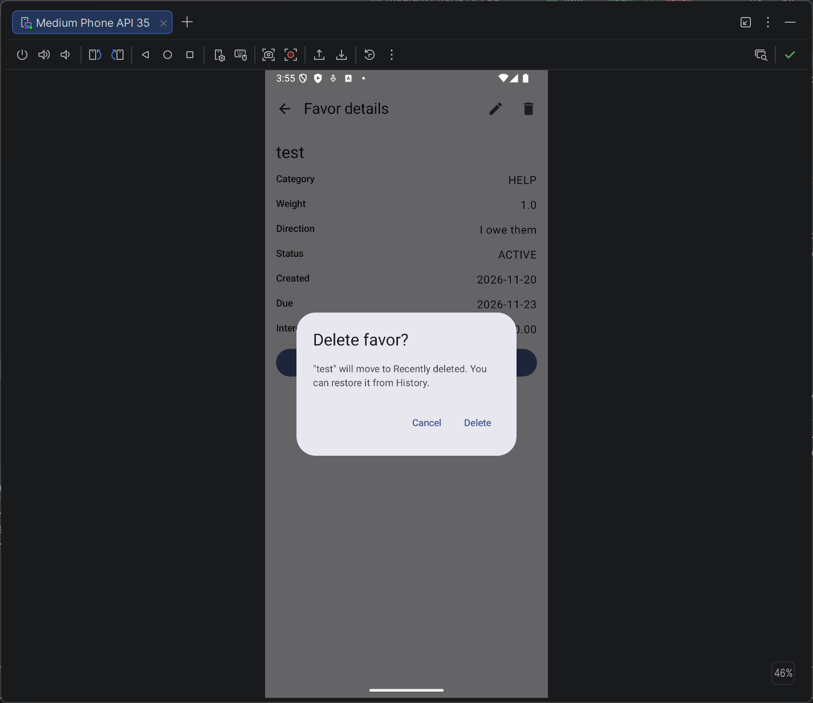 | 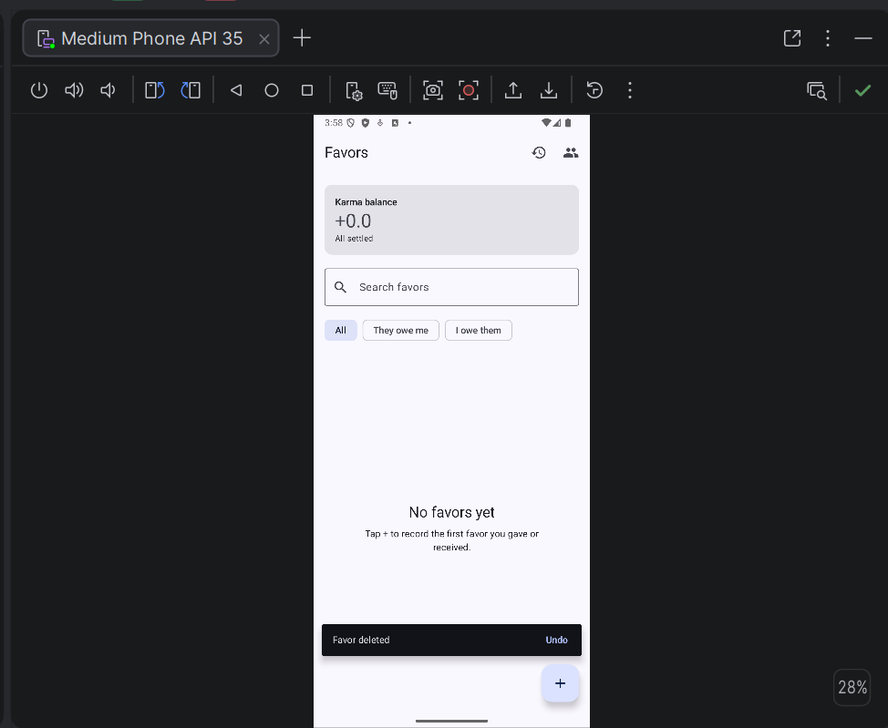 | 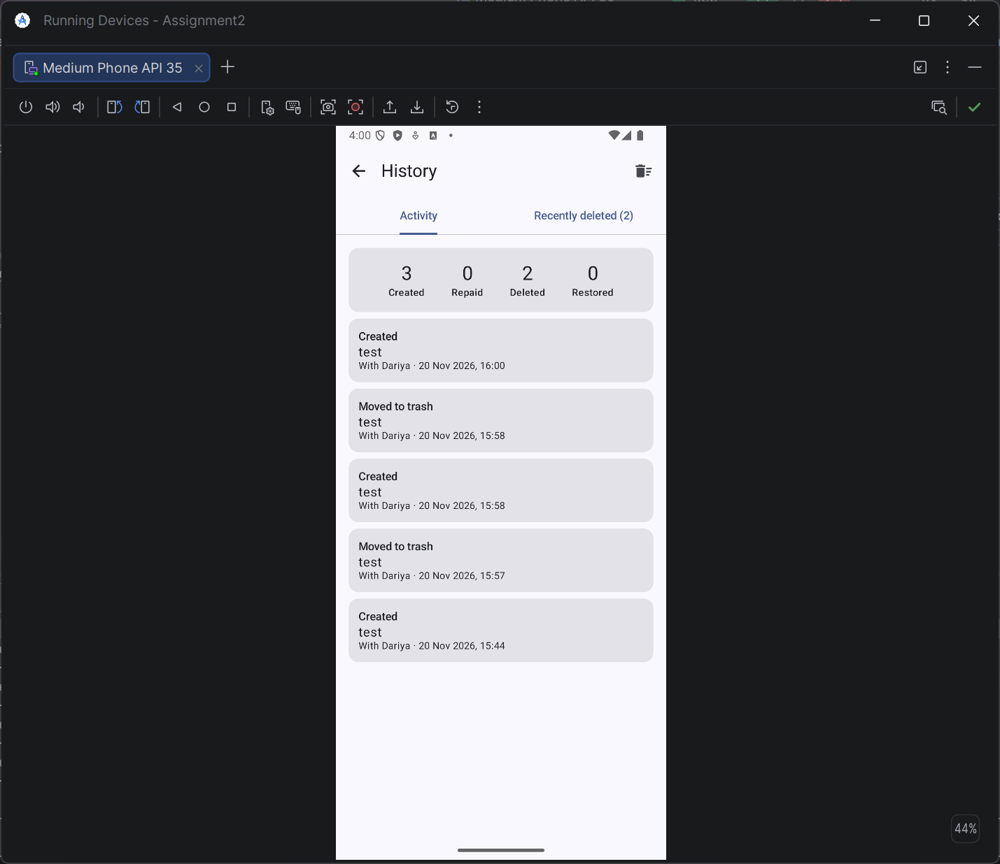 |

| 4. History: recently deleted (restore) | 5. Favor restored |
|---|---|
| 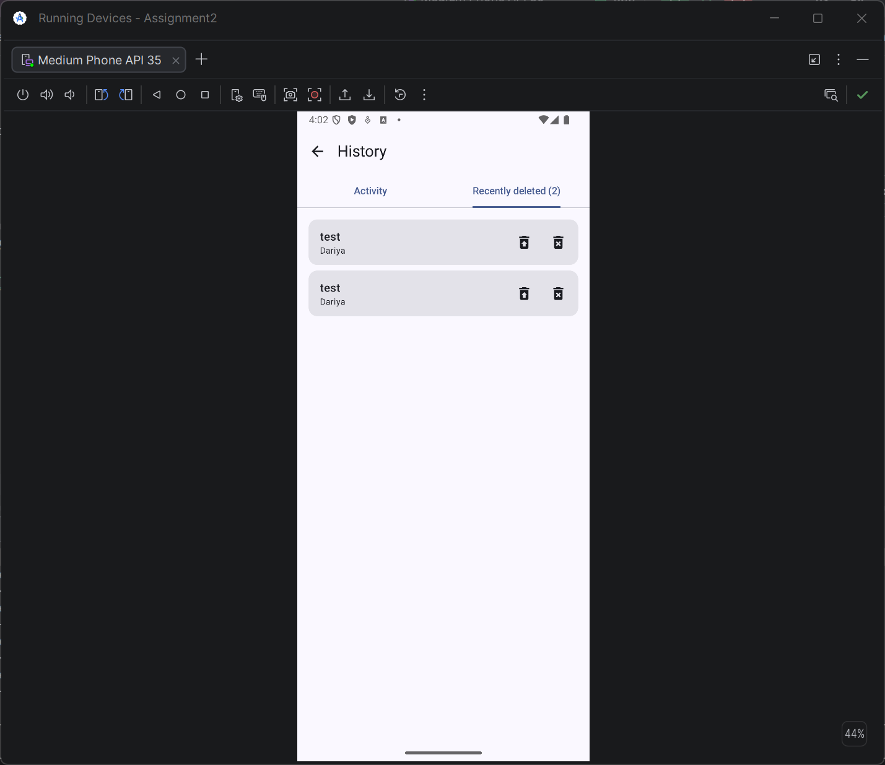 | 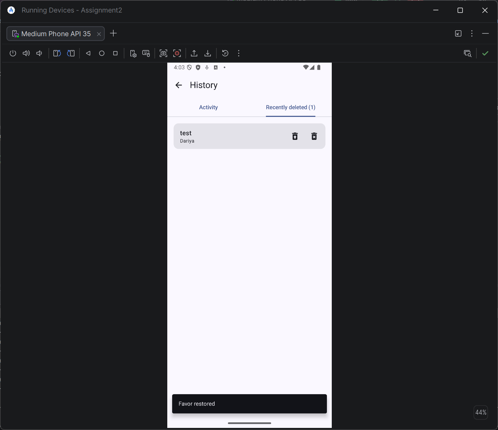 |

### Core screens
| Favor list                            | Add favor |
|---------------------------------------|---|
| 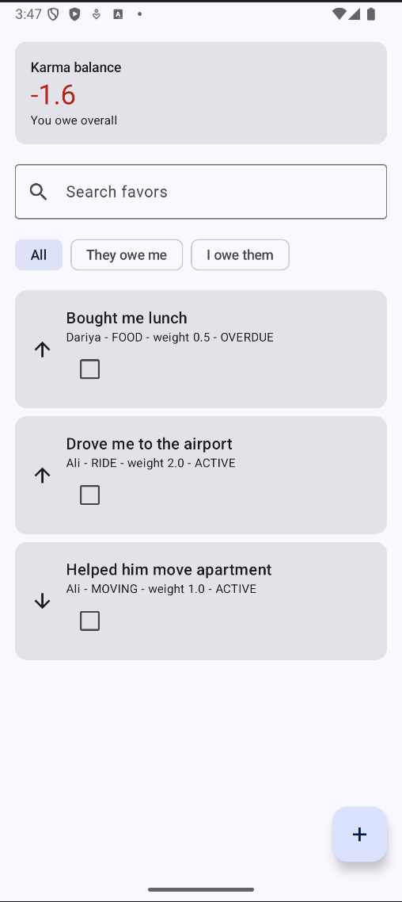 | 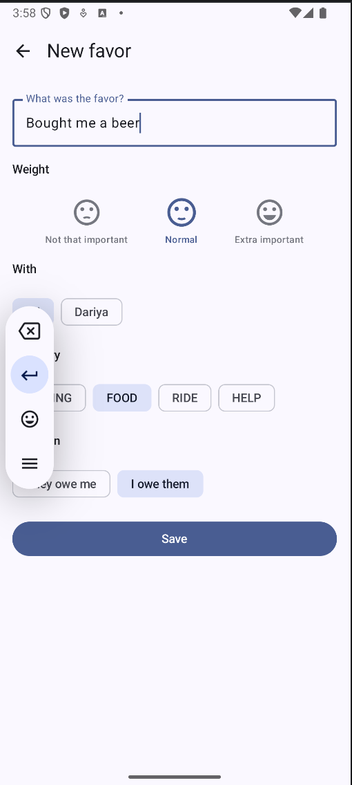 |

| Favor details | Balances                              |
|---|---------------------------------------|
| 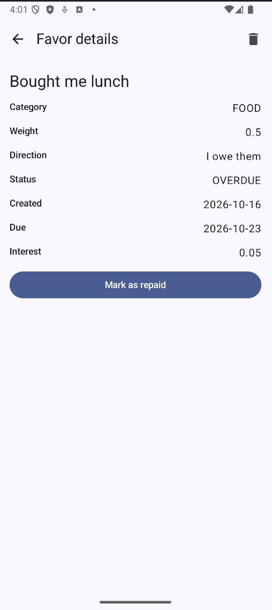 | 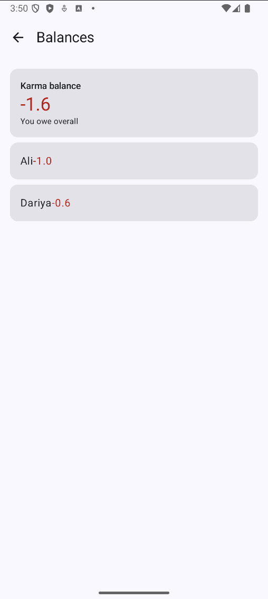 |

| After rotation (list)                           | After rotation (add form) |
|-------------------------------------------------|---|
| 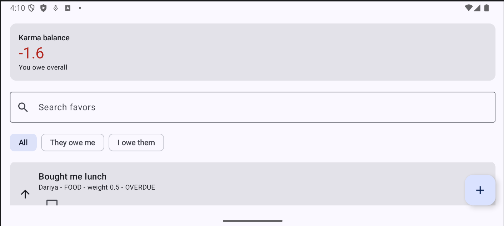 | 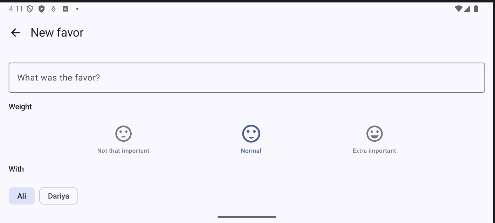 |
