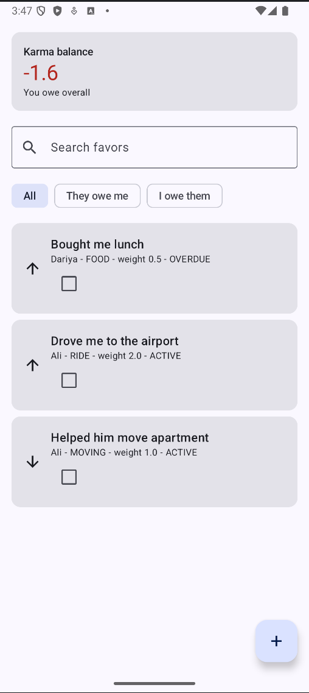
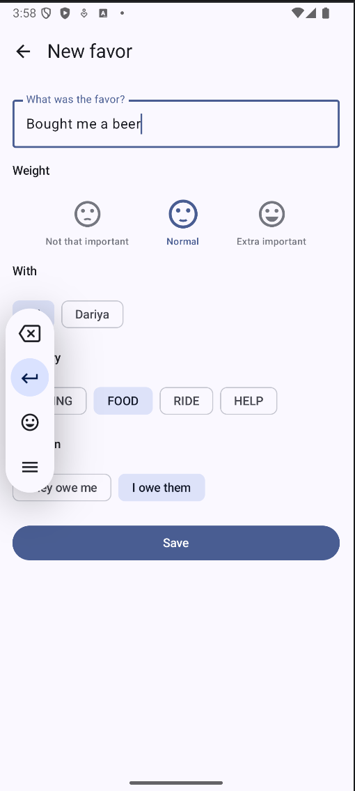
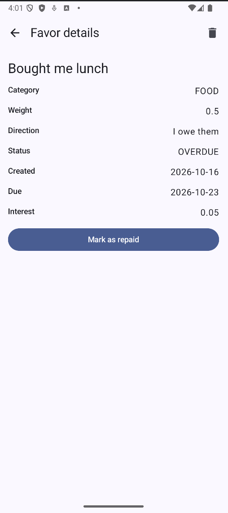
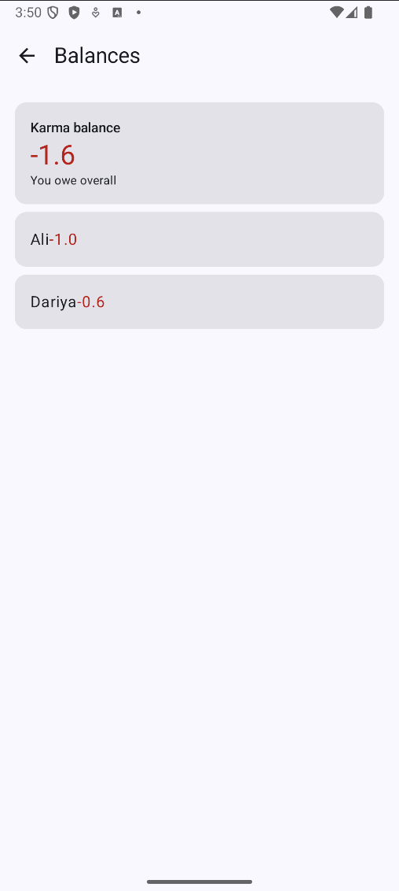
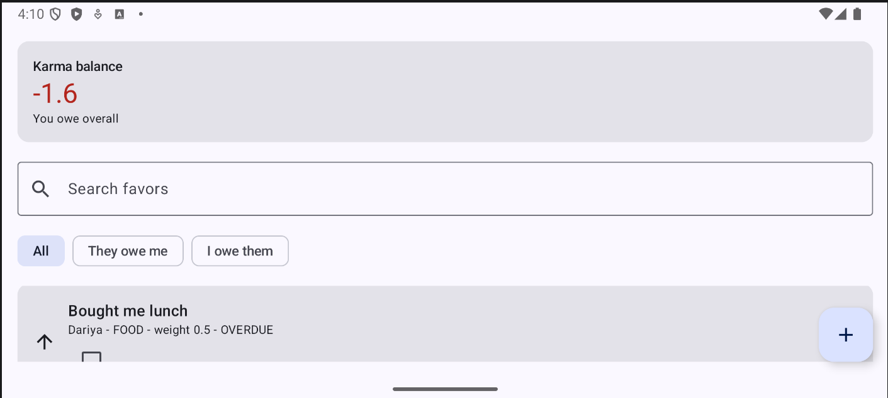
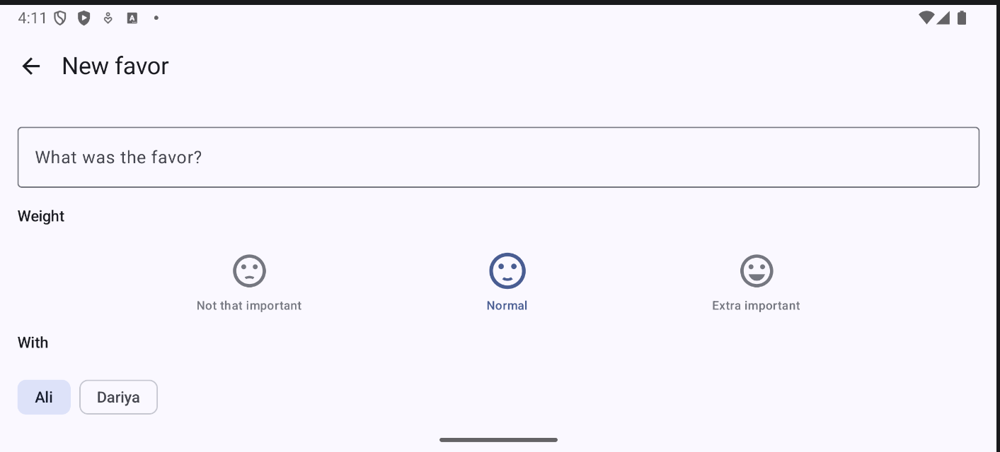

# Favor Ledger

An Android app (Kotlin, Jetpack Compose, Material 3) for keeping track of the favors you owe and the favors others owe you. Friends often lose track of who helped whom, and "I'll get you back" is easy to forget. Favor Ledger records each favor with a weight, a category and a due date, then shows a running **karma balance** per person and overall. Overdue favors accrue interest, which gently nudges you to settle up.

It continues the HW1 domain model (`Favor`, `Ledger`, `InterestPolicy`, ...), now backed by a ViewModel and a multi-screen Compose UI.

## Features
1. **Favor list with search and filter.** Search by description (debounced with a coroutine Flow) and filter by direction: All / They owe me / I owe them. Overdue favors are sorted first, repaid favors last.
2. **Add a favor.** Description, the person, a category, a direction, and an **importance** chosen with three smiley faces (not that important / normal / extra important). Each importance maps to a fixed weight (0.5 / 1.0 / 2.0). The Save button stays disabled while the description is blank.
3. **Favor details.** Category, weight, direction, status (ACTIVE / OVERDUE / REPAID), created and due dates, and the interest accrued so far. You can mark a favor as repaid (or undo it) and delete it.
4. **Balances.** A karma card shows what you are owed or owe overall; a balances screen breaks it down per person. Interest is added to unpaid favors that stay open past each interval.
5. **Simulated loading.** The sample data loads asynchronously in `viewModelScope` while a progress indicator is shown.

## Screens and navigation
Navigation Compose with one `NavHost` (`ui/AppNav.kt`):

| Route | Screen | Notes |
|---|---|---|
| `list` | `FavorScreen` | Start destination: karma card, search, filter, favor list, add button |
| `add` | `AddFavorScreen` | Form for a new favor |
| `detail/{favorId}` | `DetailScreen` | Only the favor id is passed; the screen looks the favor up in the ViewModel state |
| `stats` | `StatsScreen` | Opened by tapping the karma card |

## Architecture
- `model/`: plain Kotlin domain classes (`Favor`, `Ledger`, `Person`, `Category`, `Direction`, `Importance`, `InterestPolicy`, ...). No Android dependencies.
- `ui/FavorViewModel.kt`: application logic. Holds the `Ledger` and exposes one `StateFlow<FavorUiState>`. Handles add / repay / delete, search (with `debounce` and `distinctUntilChanged`) and filtering.
- `ui/FavorUiState.kt`: immutable screen state, including the derived `visibleFavors` and `karma`.
- `ui/*Screen.kt`: composables that only render state and send events. Screens collect state with `collectAsStateWithLifecycle`.
- `ui/Components.kt`: reusable composables (`FavorCard`, `KarmaCard`, `SearchBar`, `DirectionFilter`, `WeightSelector`, ...).

A single `FavorViewModel` is created in `AppNav` and shared by all screens, so the data is the same everywhere.

### State handling
| | Survives recomposition | Survives rotation | Survives process death |
|---|---|---|---|
| `remember` | yes | no | no |
| `rememberSaveable` | yes | yes | yes |
| `ViewModel` | yes | yes | no |

- The favors, balances, search text and filter live in the ViewModel, so they survive rotation.
- The add form draft (description, person, category, direction, importance) uses `rememberSaveable`, so a half-filled form survives rotation.
- Composables such as `WeightSelector` are stateless: they receive the selected value and an `onSelect` callback (state hoisting).
- The ledger is kept in memory only, so favors are lost when the process is killed (persistence is planned for later).

## Running
1. Open the project in Android Studio (Ladybug or newer) with JDK 11+.
2. Let Gradle sync.
3. Select an emulator or device (API 26+) and press **Run**.
4. Rotate the emulator (Ctrl + Left/Right arrow) to check that state is kept.

## Screenshots
| Favor list                            | Add favor |
|---------------------------------------|---|
|  |  |

| Favor details | Balances                              |
|---|---------------------------------------|
|  |  |

| After rotation (list)                           | After rotation (add form) |
|-------------------------------------------------|---|
|  |  |
