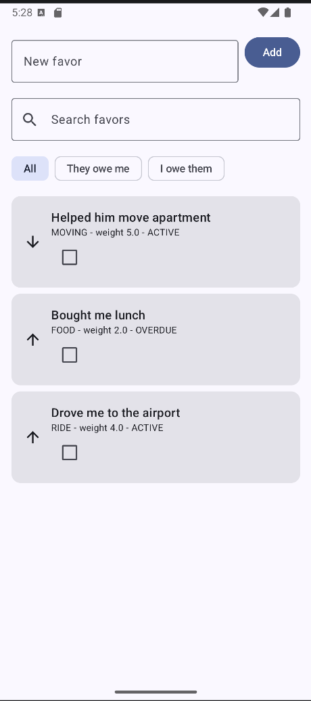
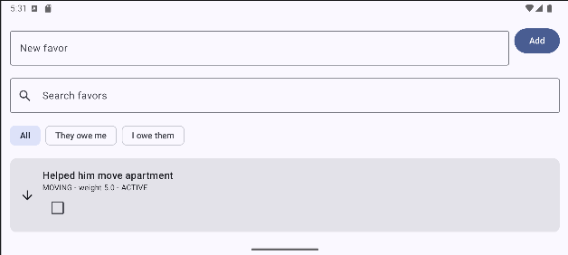
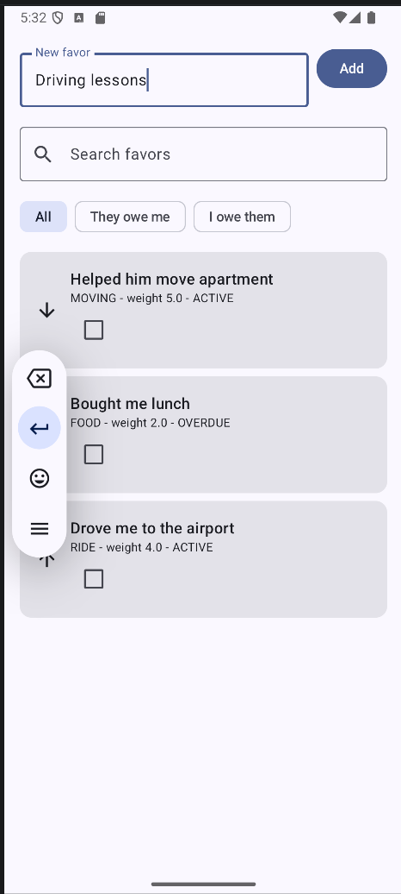
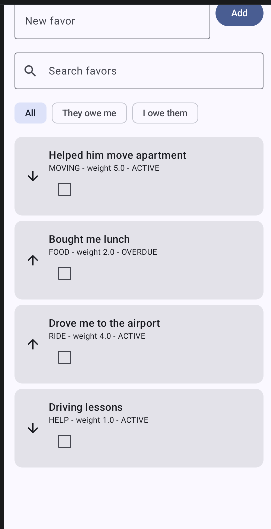
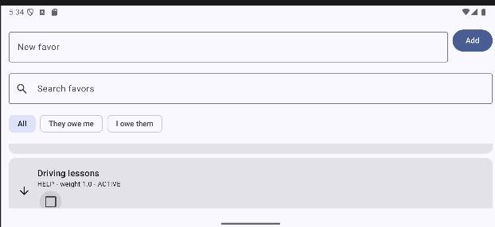
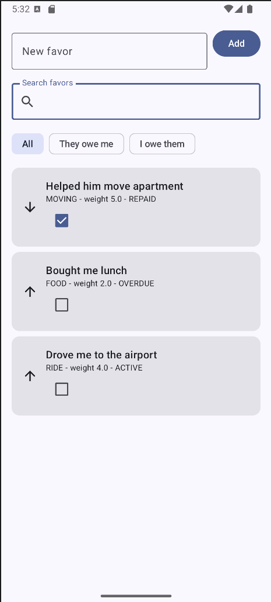
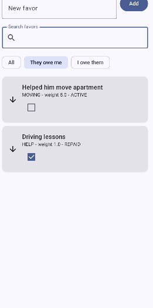
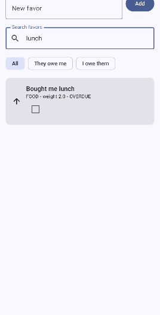

# Favor Ledger (Assignment 2)

An Android app (Kotlin, Jetpack Compose, Material 3, ViewModel) for tracking favors you owe and favors others owe you. It continues the HW1 domain model (`Favor`, `Ledger`, `Category`, `Direction`, ...), which lives in the `model` package.

## Features
- Add a new favor with the text field and **Add** button.
- Search favors by description (`OutlinedTextField`).
- Filter by direction with chips: All / They owe me / I owe them.
- Mark a favor as repaid or undo it with a `Checkbox`. The status (e.g. overdue) is computed by the HW1 logic.
- `LazyColumn` of `Card`s built with `Row`/`Column`.
- State demo row with three buttons: `remember`, `rememberSaveable`, `ViewModel`.

## Architecture
- `model/`: HW1 classes (plain Kotlin).
- `ui/FavorViewModel.kt` and `ui/FavorUiState.kt`: screen state in a `StateFlow`, plus all logic (add, repay, search, filter).
- `ui/FavorScreen.kt`: stateless-ish screen that collects state with `collectAsStateWithLifecycle`.
- `ui/Components.kt`: reusable composables `FavorCard`, `SearchBar`, `DirectionFilter`, `RotationDemo`.

## remember vs rememberSaveable vs ViewModel
| | Survives recomposition | Survives rotation | Survives process death |
|---|---|---|---|
| `remember` | yes | no | no |
| `rememberSaveable` | yes | yes (saved in a Bundle) | yes |
| `ViewModel` | yes | yes (kept in memory) | no |

Rotation demo: tap each of the three buttons in the demo row a few times, then rotate the device. The `remember` counter resets to 0, while the `rememberSaveable` and `VM` counters keep their values. The list, search text and filter (ViewModel) also survive, and so does the "New favor" draft (`rememberSaveable`).

## Running
1. Open the project in Android Studio (Ladybug or newer), JDK 11+.
2. Let Gradle sync.
3. Pick an emulator or device (API 26+) and press **Run**.
4. Rotate the emulator (Ctrl+Left/Right arrow) to see the state behavior.

## Screenshots
| Main screen                               | After rotation                                |
|-------------------------------------------|-----------------------------------------------|
|              |            |
|       |                                               |
|        |  |
|  |                                               |
|            |                                               |
|            |                                               |

